<div align="center">

# DataSleuth AI

### Investigate your data. Trust the evidence.

An autonomous CSV data quality investigation platform that separates **LLM investigation planning** from **deterministic Python computation**, validates every numerical claim against executed tool outputs, and delivers auditable reports without modifying your source data.

[](https://www.python.org/)
[](https://streamlit.io/)
[](https://pandas.pydata.org/)
[](https://plotly.com/)
[](https://groq.com/)
[](https://docs.pytest.org/)

**Live Demo:** `[Streamlit Community Cloud URL — Pending Deployment from main]`

</div>

---

## Table of Contents

- [Product Tour & Screenshots](#product-tour--screenshots)
- [Engineering Motivation](#engineering-motivation)
- [Core Capabilities](#core-capabilities)
- [Dual-Engine Architecture](#dual-engine-architecture)
- [Agent Execution Lifecycle](#agent-execution-lifecycle)
- [Deterministic Analysis Tools](#deterministic-analysis-tools)
- [Evidence Validation & Reliability](#evidence-validation--reliability)
- [Two Investigation Modes](#two-investigation-modes)
- [Data Privacy & Security](#data-privacy--security)
- [Technology Stack](#technology-stack)
- [Sample Dataset Library](#sample-dataset-library)
- [Installation & Configuration](#installation--configuration)
- [Testing & Quality Assurance](#testing--quality-assurance)
- [Project Structure](#project-structure)
- [Deployment (Streamlit Community Cloud)](#deployment-streamlit-community-cloud)

---

## Product Tour & Screenshots

| Standalone Landing Page | Dedicated Dataset Onboarding |
| :---: | :---: |
| 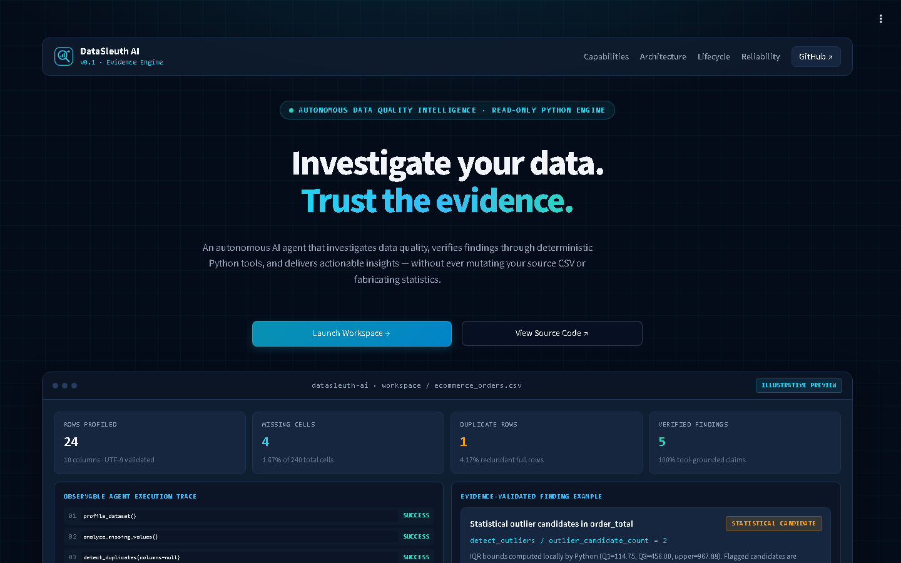 | 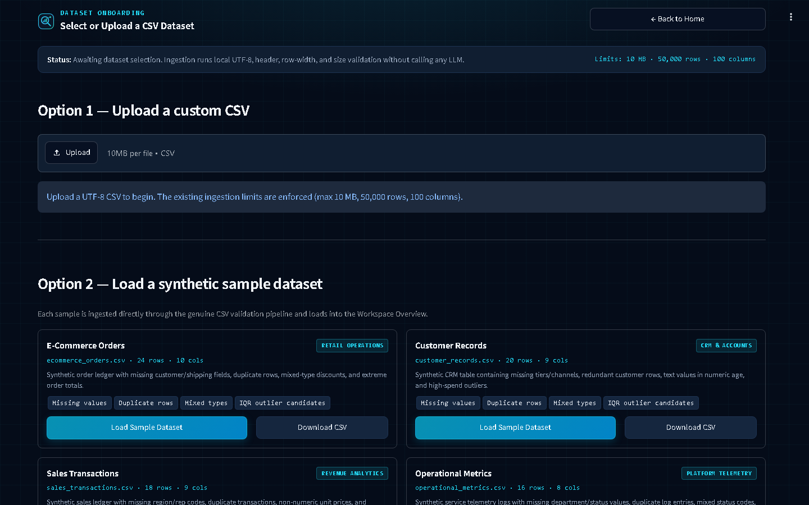 |

| Dataset Overview | Investigation Center |
| :---: | :---: |
| 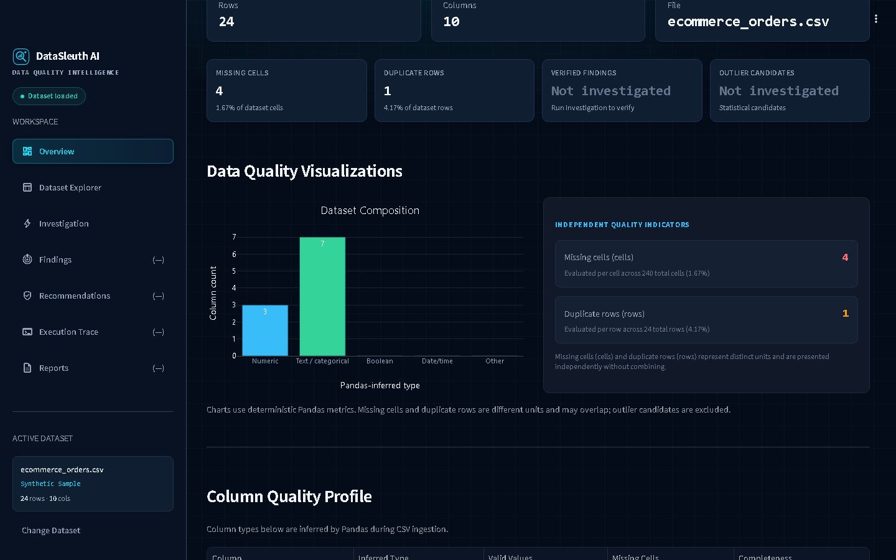 | 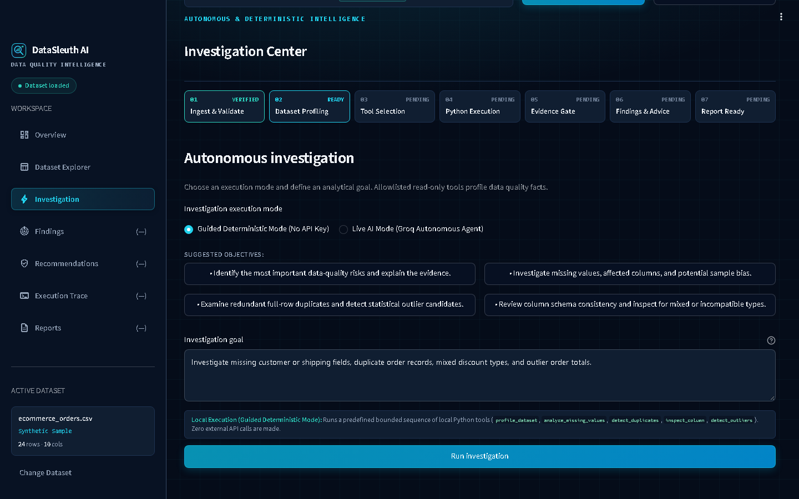 |

| Completed Investigation | Verified Findings |
| :---: | :---: |
| 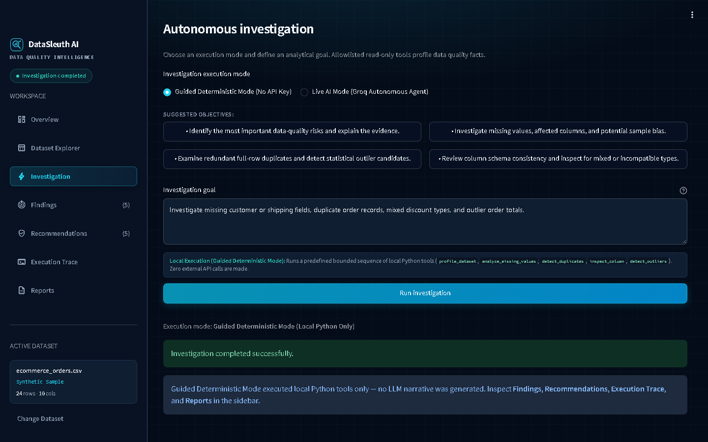 | 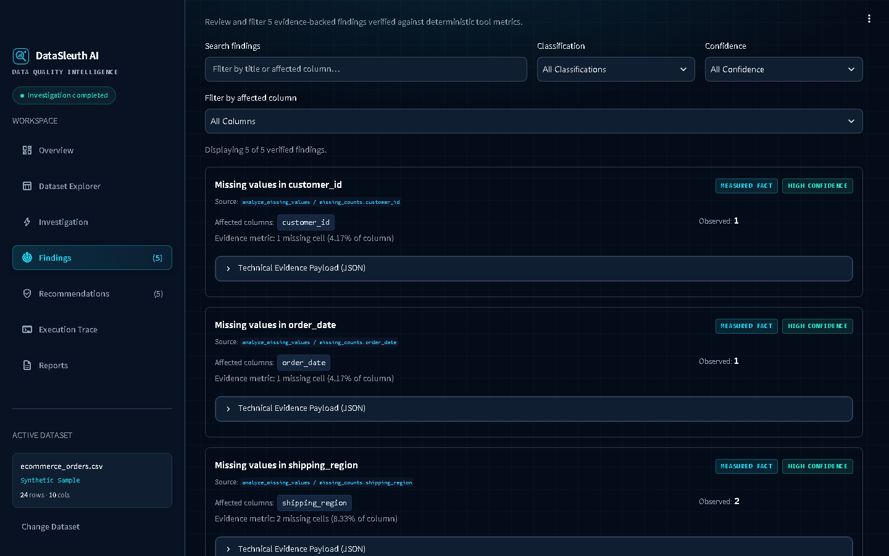 |

| Cleaning Recommendations | Execution Trace |
| :---: | :---: |
| 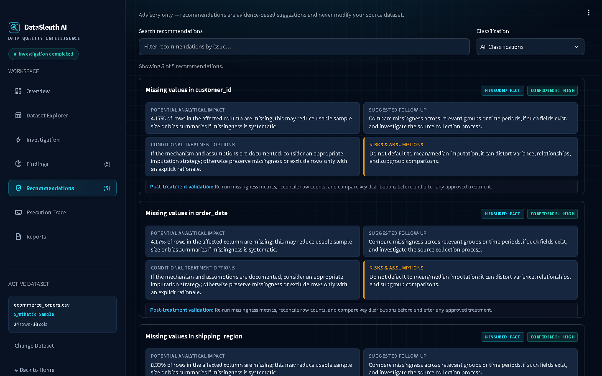 | 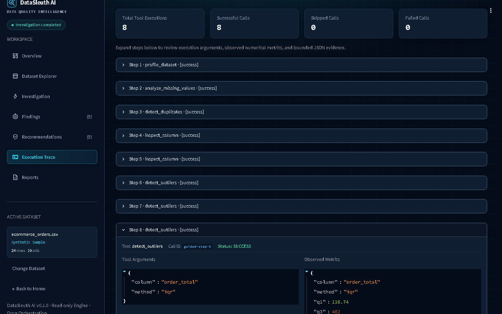 |

| Report Center (JSON & Markdown Exports) |
| :---: |
| 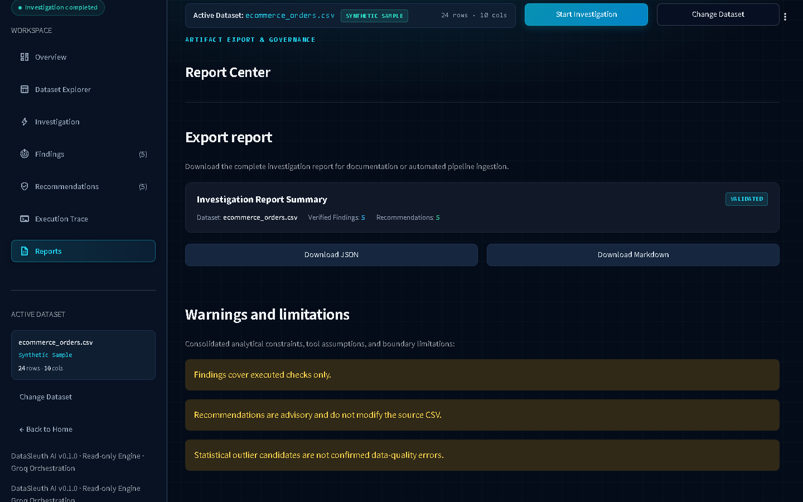 |

---

## Engineering Motivation

Standard AI chatbots cannot be trusted to compute data quality statistics directly from raw CSV text:

1. **Token & Context Limits:** Sending entire datasets to an LLM is expensive, leaks raw records, and fails on medium-to-large tables.
2. **Unverified Arithmetic:** Language models frequently hallucinate counts, percentages, and quantiles when summarizing tabular data.
3. **Opaque Reasoning:** A chat reply does not provide an auditable trail of which checks ran, which columns were inspected, or which rows triggered a warning.

**DataSleuth AI solves this by separating planning from computation:** the LLM (in Live AI Mode) only decides *which* allowlisted tool to run next using schema metadata and bounded summaries, while all numerical calculations execute deterministically in local Python/Pandas and pass through an evidence validation gate.

---

## Core Capabilities

- **Validated CSV Ingestion (`data_loader.py`):** UTF-8 / UTF-8-with-BOM decoding, duplicate-header rejection, consistent row-width verification, and strict size/shape bounds (`10 MB`, `50,000` rows, `100` columns).
- **Dataset Profiling:** Exact row/column counts, Pandas-inferred dtypes, non-null counts, numerical `describe()` statistics, and bounded categorical cardinality.
- **Missing-Value Analysis:** Exact missing cell counts, column-level percentages, affected row counts, fully empty columns, and bounded affected row positions.
- **Duplicate Detection:** Full-row and key-column redundant row counts, duplicate-group row counts, and bounded example records.
- **Column Inspection:** Per-column dtype inspection, observed Python types, mixed-type detection, and numeric conversion probe failure counts.
- **Conservative IQR Outlier Detection:** Local Q1, Q3, IQR, and `1.5 × IQR` fence computation, explicitly labeled as statistical candidates rather than confirmed errors.
- **Evidence Validation (`validator.py`):** Verifies numerical claims against observed `ToolResult` metrics and isolates LLM narrative as unverified interpretation.
- **Grounded Recommendations & Exports (`reports.py`):** Advisory-only cleaning guidance, strict JSON (`allow_nan=False`), and HTML/Markdown-escaped reports.
- **Deterministic Visualizations (`visualizations.py`):** Interactive Plotly dataset-composition charts and independent quality indicators.

---

## Dual-Engine Architecture

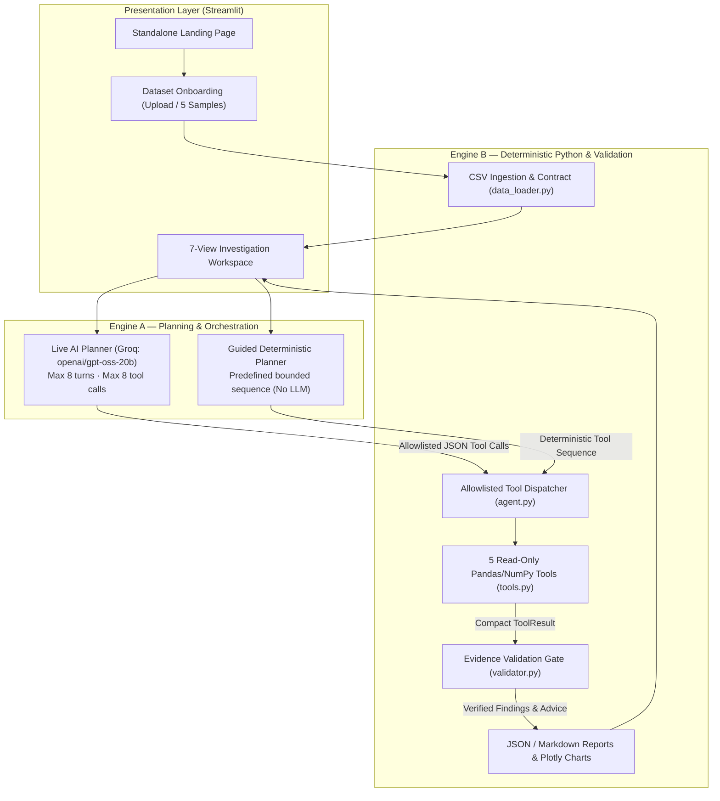

---

## Agent Execution Lifecycle

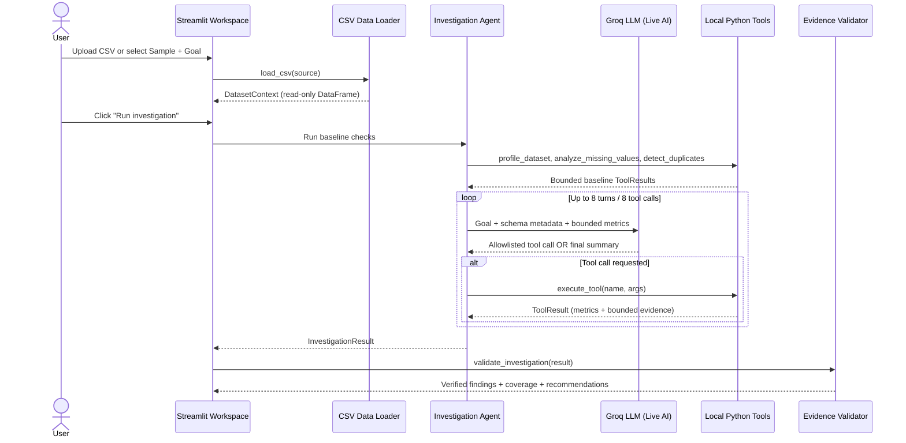

---

## Deterministic Analysis Tools

| Tool Name | Purpose | Inputs | Key Metrics & Statistical Definitions |
| :--- | :--- | :--- | :--- |
| `profile_dataset` | Structural & type summary | None | `row_count`, `column_count`, `missing_value_count`, `per_column` dtypes, `numerical_statistics`, `categorical_cardinality` |
| `analyze_missing_values` | Missingness audit | None | `missing_counts`, `missing_percentages` (`missing / row_count * 100`), `rows_with_missing_count`, `fully_empty_columns`, `affected_row_positions` (max 10) |
| `detect_duplicates` | Redundant row detection | `columns` (optional) | `duplicate_row_count` (`keep="first"` redundant rows), `duplicate_percentage`, `duplicate_group_row_count` (`keep=False`), bounded `evidence` |
| `inspect_column` | Single-column deep check | `column` (required) | `inferred_dtype`, `unique_value_count`, `observed_python_types`, `mixed_types_detected`, `numeric_conversion_failure_count` |
| `detect_outliers` | Conservative anomaly candidates | `column` (required), `method="iqr"` | `q1`, `q3`, `iqr`, `lower_bound` (`Q1 - 1.5*IQR`), `upper_bound` (`Q3 + 1.5*IQR`), `outlier_candidate_count` (requires >= 4 finite values; skipped if `IQR == 0`) |

---

## Evidence Validation & Reliability

- **Tool-Grounded Findings:** `validate_investigation()` derives findings solely from successful tool `metrics` and rejects unsupported or mismatched numerical claims in `validate_finding()`.
- **Bounded Execution:** `InvestigationAgent` enforces `MAX_AGENT_TURNS = 8`, `MAX_AGENT_TOOL_CALLS = 8`, and stops on repeated identical tool calls.
- **Allowlisting & Argument Validation:** `execute_tool()` validates tool names against the 5-tool `_DISPATCH` map, rejects unexpected parameters, and verifies column names against `context.dataframe.columns`.
- **Groq Error Handling:** `GroqClient` enforces a `30.0s` timeout, `MAX_GROQ_RETRIES = 2` for rate limits/timeouts/connections/5xx errors, one lower-temperature recovery (`0.2`) for `invalid_tool_call` HTTP 400 errors, and classifies `context_size` / `authentication` failures without retrying.
- **Honest Incomplete States:** Partial tool observations are preserved as `incomplete` if an agent loop hits limits or fails mid-run; failures are never masked as clean datasets.
- **Stale State Invalidation:** Uploading or switching datasets assigns a new `dataset_id` and SHA-256 signature, clearing prior `investigation_result` and `report` state.

> **Important Note:** Evidence validation guarantees that verified findings match executed tool outputs, but it does **not** eliminate all LLM interpretation errors in the narrative summary (`model_interpretation`), which is explicitly isolated and labeled as unverified.

---

## Two Investigation Modes

| Feature | Guided Deterministic Investigation (Public Default) | Live AI Investigation (Optional) |
| :--- | :--- | :--- |
| **API Key Required** | **No** | Yes (`GROQ_API_KEY` server-side) |
| **Tool Selection** | Predefined bounded local Python sequence | Autonomous Groq LLM (`openai/gpt-oss-20b`) |
| **External Network Calls** | **Zero** | Bounded Groq Chat Completions API |
| **Evidence Validation** | Full `validate_investigation()` pipeline | Full `validate_investigation()` pipeline |
| **Model Narrative** | `None` (never fabricated) | Sanitized `model_interpretation` (labeled unverified) |
| **Public Deployment Safety** | Unrestricted | Protected by `DATASLEUTH_PUBLIC_DEMO_MODE`, `MAX_SESSION_LIVE_RUNS = 5`, and `MAX_GLOBAL_LIVE_RUNS = 20` |

---

## Data Privacy & Security

- **Read-Only Source CSV:** Ingestion creates an in-memory Pandas DataFrame; the original file is never modified and no automatic data cleaning is performed.
- **Secret Management:** `GROQ_API_KEY` is read strictly from server environment variables / `.env` (`load_dotenv(override=False)`) and is never rendered in UI, logs, or exported reports.
- **Untrusted Data Isolation:** CSV cell values are treated as untrusted data, never agent instructions. Live AI prompts receive column names, dtypes, and bounded tool summaries rather than raw CSV dumps.
- **Report Escaping:** `report_to_markdown()` escapes HTML and Markdown control characters (`<`, `>`, `` ` ``, `[`, `]`), and `sanitize_model_markdown()` strips unsafe HTML tags (`<script>`, `<iframe>`, etc.).
- **Session Isolation:** Each Streamlit user session holds its own `st.session_state` with no shared database.
- **Known Limitations:** Public deployments without a server-side `GROQ_API_KEY` (or with `DATASLEUTH_PUBLIC_DEMO_MODE=true`) operate in Guided Deterministic Mode only.

---

## Technology Stack

| Layer | Technology | Verified Version |
| :--- | :--- | :--- |
| **Runtime** | Python | `3.13.1` (`>=3.10` supported) |
| **Data Engine** | Pandas / NumPy | `3.1.1` / `2.5.5` |
| **Web Workspace** | Streamlit | `1.67.0` |
| **Visualizations** | Plotly | `7.1.0` |
| **LLM Integration** | Groq Python SDK | `1.7.0` |
| **Configuration** | python-dotenv | `1.2.4` |
| **Testing** | Pytest | `9.2.0` |

---

## Sample Dataset Library

All five synthetic datasets are bundled in `data/samples/` and contain **no real personal information**:

| Dataset | Filename | Dimensions | Included Data Quality Scenarios |
| :--- | :--- | :--- | :--- |
| **E-Commerce Orders** | `ecommerce_orders.csv` | `24 × 10` | Missing `customer_id`/`order_date`/`shipping_region`, duplicate order row, mixed `discount_pct` (`"none"`), `order_total` outliers |
| **Customer Records** | `customer_records.csv` | `20 × 9` | Missing `account_tier`/`contact_channel`, duplicate row, mixed `age_years` (`"thirty"`), `lifetime_spend` outlier |
| **Sales Transactions** | `sales_transactions.csv` | `18 × 9` | Missing `region`/`rep_code`, duplicate row, mixed `unit_price` (`"N/A"`), negative/extreme `units_sold` |
| **Operational Metrics** | `operational_metrics.csv` | `16 × 8` | Missing `department`/`status_code`, duplicate log row, mixed `status_code` (`"unknown"`), `latency_ms` spike |
| **Enterprise Invoice Ledger** | `enterprise_invoice_ledger.csv` | `2,000 × 10` | Reproducibly generated (`scripts/generate_sample_ledger.py`, `seed=42`) with missing `payment_date`/`region`/`customer_segment`, 30 duplicate rows, mixed `discount_rate`, and `invoice_amount` outliers |

---

## Installation & Configuration

### Windows (PowerShell)

```powershell
git clone https://github.com/aymenALa/datasleuth-ai.git
cd datasleuth-ai
py -m venv .venv
.\.venv\Scripts\Activate.ps1
python -m pip install -r requirements.txt
python -m pip install -e .
```

### Linux / macOS

```bash
git clone https://github.com/aymenALa/datasleuth-ai.git
cd datasleuth-ai
python3 -m venv .venv
source .venv/bin/activate
python -m pip install -r requirements.txt
python -m pip install -e .
```

### Run in Guided Deterministic Mode (No API Key Required)

```powershell
streamlit run app.py
```

### Optional: Enable Local Live AI Mode (Groq)

```powershell
Copy-Item .env.example .env
# Edit .env and set GROQ_API_KEY=your_local_key
streamlit run app.py
```

### Run Tests

```powershell
python -m pytest -v
```

---

## Testing & Quality Assurance

- **Automated Test Suite:** **117 / 117** Pytest tests passing across ingestion, deterministic tools, mocked agent orchestration, evidence validation, report escaping, Plotly visualizations, 5 sample datasets (including 2,000-row ledger), quota locks, and Streamlit `AppTest` navigation.
- **Live Groq Integration Check:** Verified against `ecommerce_orders.csv` (`openai/gpt-oss-20b`): autonomous 5-step execution (`profile_dataset`, `analyze_missing_values`, `detect_duplicates`, `inspect_column`, `detect_outliers`), `completion_status="validated"`, `5` verified findings, `5` recommendations, `4,643` total tokens, valid JSON and Markdown exports.
- **Real Browser QA (Headless Chrome CDP):** Verified desktop (`1440×900`), tablet (`768×1024`), and mobile (`390×844`) with `0px` horizontal overflow, `0` console/page errors, and real browser file downloads of `datasleuth-report.json` and `datasleuth-report.md`.

---

## Project Structure

```text
datasleuth-ai/
├── .streamlit/
│   └── config.toml                 # Midnight-cyan theme & 10 MB maxUploadSize
├── data/samples/                   # 5 bundled synthetic CSV datasets
├── docs/screenshots/               # Application screenshots for documentation
├── scripts/
│   └── generate_sample_ledger.py   # Reproducible 2,000-row CSV generator (seed=42)
├── src/datasleuth/
│   ├── agent.py                    # Bounded Groq tool-calling loop & dispatcher
│   ├── config.py                   # Limits, model, temperature, retry & quota config
│   ├── data_loader.py              # Validated UTF-8 CSV ingestion & DatasetContext
│   ├── demo_runner.py              # Guided Deterministic Mode (no LLM)
│   ├── groq_client.py              # Retry-bounded Groq SDK boundary & error diagnosis
│   ├── models.py                   # Shared dataclasses (DatasetContext, ToolResult, etc.)
│   ├── reports.py                  # Conservative recommendations, JSON & escaped Markdown
│   ├── sample_datasets.py          # Synthetic sample registry & loader
│   ├── tools.py                    # 5 deterministic, read-only Pandas/NumPy tools
│   ├── validator.py                # Post-execution evidence validation gate
│   ├── visualizations.py           # Deterministic Plotly charts
│   └── ui/
│       ├── brand.py                # Custom SVG logo & GitHub constants
│       ├── formatters.py           # Precision formatting & HTML/Markdown sanitization
│       ├── navigation.py           # Workspace sidebar & factual status pills
│       ├── theme.py                # Midnight-cyan CSS design tokens & layout rules
│       ├── view_models.py          # Presentation view models & KPI calculations
│       └── views/                  # Landing, Onboarding, Overview, Explorer, Investigation,
│                                   # Findings, Recommendations, Trace & Reports views
├── tests/                          # 117-test Pytest suite
├── app.py                          # Streamlit 3-stage entry point
├── pyproject.toml                  # Package metadata
└── requirements.txt                # Runtime & test dependencies
```

---

## Deployment (Streamlit Community Cloud)

DataSleuth AI is natively compatible with **Streamlit Community Cloud** at **$0/month**:

- **Repository:** `aymenALa/datasleuth-ai`
- **Branch:** `main`
- **Main file path:** `app.py`
- **Python version:** `3.11` or `3.12` (or `3.13`)
- **Secrets:** Leave `GROQ_API_KEY` unset for a pure zero-cost public Guided Deterministic deployment (or set `DATASLEUTH_PUBLIC_DEMO_MODE = "true"` to lock Live AI Mode).

Why native Streamlit hosting: DataSleuth's core value is genuine Python/Pandas computation and real-time Plotly/Streamlit state. Keeping a single-process Python deployment avoids split-service cold starts, CORS complexity, and paid backend infrastructure.
