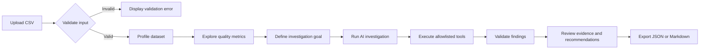
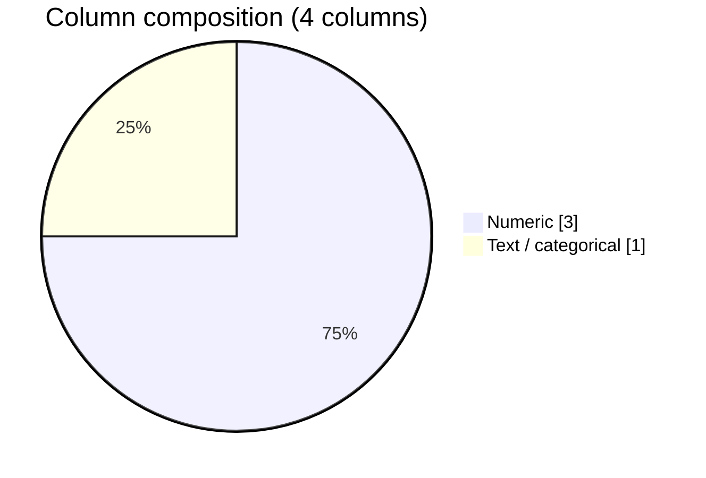
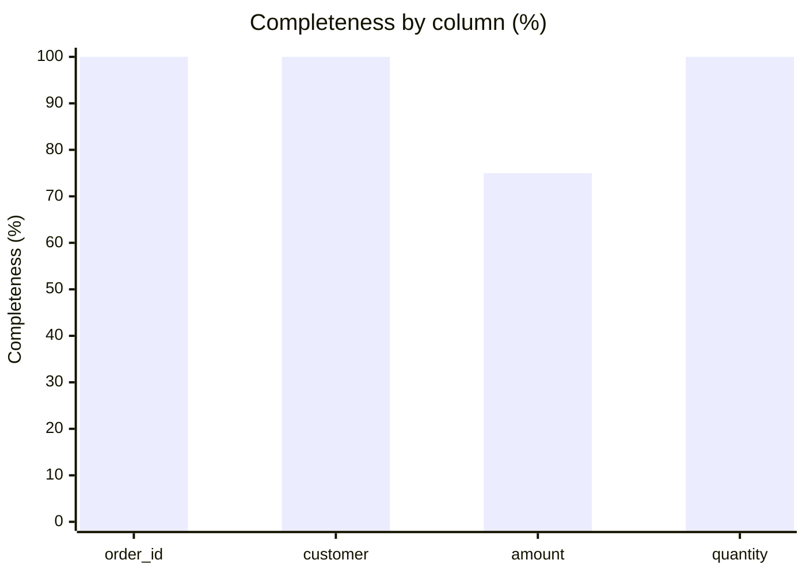
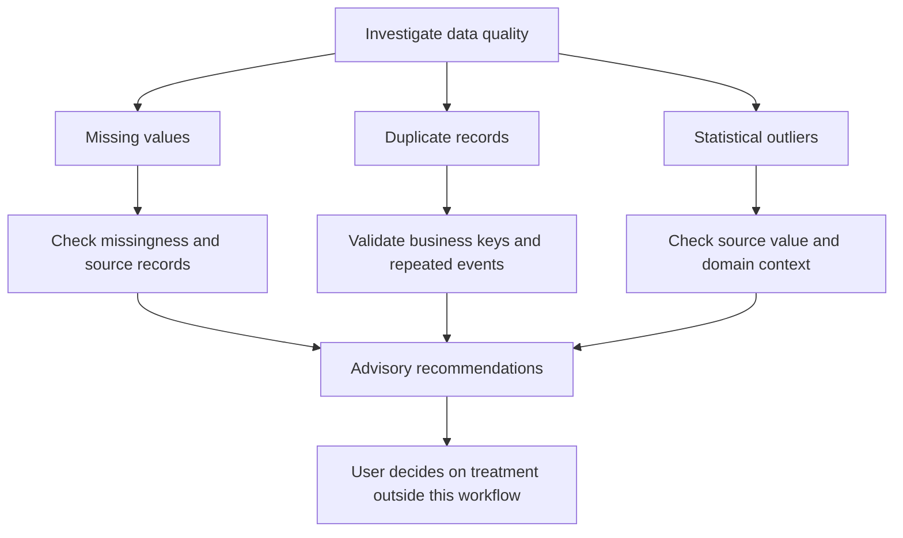
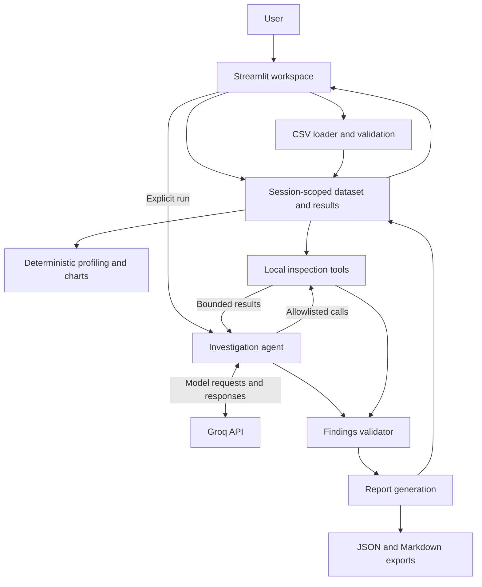
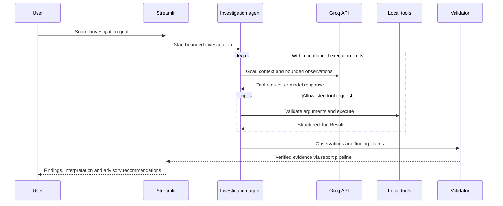
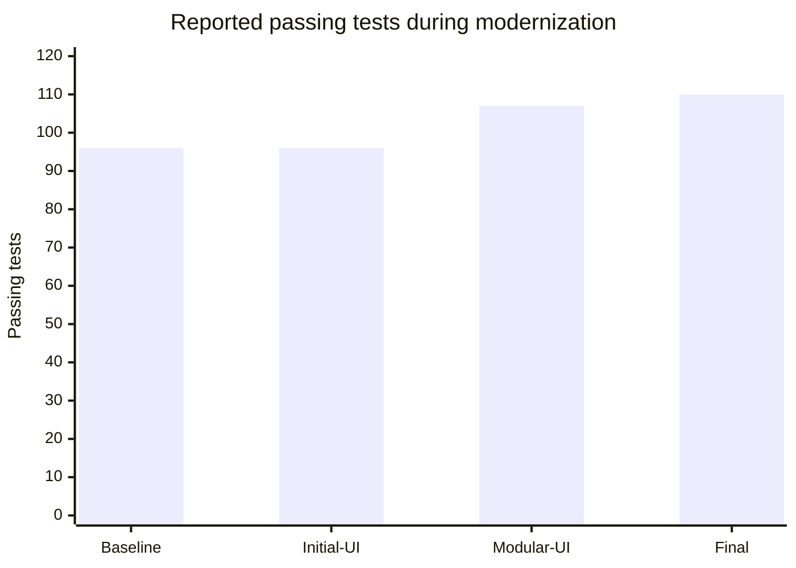

# DataSleuth AI

**Evidence-first AI data quality investigation for CSV datasets.**

     

DataSleuth AI helps analysts and developers investigate the quality of a dataset **before** cleaning it or using it for analytics, machine learning, or reporting. It combines deterministic Python-based inspection with an AI agent that coordinates investigations and explains their implications. Verified evidence, model interpretation, and advisory cleaning recommendations are kept separate.

The application is a read-only investigation workspace: it does not automatically modify source data.

## Contents

- [Implemented V1 scope](#implemented-v1-scope)
- [How it works](#how-it-works)
- [Workspace](#workspace)
- [Example investigation](#example-investigation)
- [Architecture](#architecture)
- [Technology stack](#technology-stack)
- [Getting started](#getting-started)
- [Testing](#testing)
- [Privacy and limitations](#privacy-and-limitations)
- [Frontend modernization](#frontend-modernization)

## Implemented V1 scope

DataSleuth AI investigates CSV data before any cleaning decision. Its original V1 roadmap is now implemented, with a modernized frontend.

| Original development milestone | Delivered capability |
| --- | --- |
| Task 02 — Ingestion | Validated CSV loading from paths and binary file-like objects, UTF-8 and UTF-8-with-BOM support, and the `DatasetContext` contract. |
| Task 03 — Analytical tools | Five deterministic read-only tools, JSON-compatible `ToolResult` objects, and bounded evidence. |
| Task 04 — Agent | Bounded Groq orchestration, explicit JSON tool schemas, allowlisted dispatcher, structured execution state and bounded retries. |
| Task 05A — Evidence and reports | Deterministic verification of numerical claims, measured facts and statistical candidates, conservative recommendations, strict JSON and escaped Markdown reports. |
| Task 05B — Interface | CSV upload, bounded preview, explicit investigation controls, session persistence, stale-result invalidation and downloads. |
| Tasks 06–07 — Visualization | Deterministic Plotly charts based on actual Pandas dtypes and tool metrics, without extra AI calls. |
| PROJECT UI LAB — Modernization | Seven workspaces, modular UI, searchable findings, column filters, derived quality metrics, unified theme and navigation regression tests. Independent quality indicators supersede the original mixed-unit donut. |

### CSV input contract

- Accepts UTF-8 and UTF-8-with-BOM CSVs, with validated file size, row count, column count and column names.
- Rejects empty or whitespace-only files, malformed CSVs, duplicate column names, invalid encodings and oversized input with application-specific errors.
- **Header-only CSVs are valid:** they produce a `DatasetContext` with zero rows and declared columns. Rates with zero denominators are unavailable rather than evidence of cleanliness.
- Does not speculate about date types by parsing date-like strings; composition uses actual Pandas-inferred dtypes.

## How it works



1. Upload a CSV and inspect its inferred schema, preview, and quality metrics.
2. Define an investigation objective or select a suggested objective.
3. Explicitly run the investigation. The agent coordinates available inspection tools under bounded execution limits.
4. Review measured facts, statistical candidates, and the separately labelled AI interpretation.
5. Inspect the execution trace and export the report for further analysis or documentation.

## Workspace

| Workspace | What you can do |
| --- | --- |
| **Overview** | Inspect dataset dimensions, missing-cell and duplicate-row rates, composition charts, column completeness, and investigation status. |
| **Dataset Explorer** | Browse a bounded preview, search columns, and filter by inferred type or missingness. |
| **Investigation** | Choose or edit an objective, run the agent explicitly, and review its interpretation. |
| **Findings** | Search and filter evidence-backed findings by classification, confidence, and affected column. |
| **Recommendations** | Review potential impact, suggested follow-up, conditional treatments, risks, and validation steps. |
| **Execution Trace** | Inspect recorded tool calls, arguments, statuses, observed metrics, and technical evidence. |
| **Reports** | Review investigation metadata and limitations, then download JSON and Markdown reports. |

Navigation uses shared session state. Switching workspaces is not intended to trigger a new investigation; replacing or removing a dataset invalidates results belonging to the previous dataset.

## Example investigation

The following example reproduces the values visible in the project's demonstrated `demo_sales - Sheet1.csv` investigation. It is an illustrative case, not a built-in dataset or a promise that every model run will produce identical prose.

**Goal:** Identify the most important data-quality risks and explain the evidence.

### Dataset overview

| Indicator | Observed value | Meaning |
| --- | ---: | --- |
| Rows | 8 | Dataset records |
| Columns | 4 | `order_id`, `customer`, `amount`, `quantity` |
| Total cells | 32 | Rows × columns |
| Missing cells | 2 (6.25%) | Missing cells / all dataset cells |
| Redundant duplicate rows | 1 (12.50%) | Repeated full rows beyond the first occurrence / all rows |
| Outlier candidate in `amount` | 9,999 | Flagged by the IQR method, not a confirmed error |

### Dataset composition



### Column completeness



Missing cells and redundant duplicate rows are intentionally reported separately: they have different denominators and may overlap. They should not be combined into a single quality score.

### Three common investigation cases

| Case | Verified observation | Why it matters | Suggested follow-up |
| --- | --- | --- | --- |
| Missing values | 2 of 8 `amount` values are missing (25% of that column). | Revenue summaries may be incomplete or biased. | Investigate missingness and source collection before choosing a treatment. |
| Duplicate records | 1 redundant full row (12.5% of rows). | Counts and aggregates may be inflated. | Confirm whether the repeated record is legitimate before deduplicating. |
| Statistical outliers | `amount = 9999` was flagged as a candidate (1 of 6 eligible numeric observations). | Extreme values can affect means, variance, and downstream models. | Validate against source records and domain context; do not automatically remove it. |



## Architecture

The interface is separated from the core investigation engine. Streamlit manages the workspace and session-scoped presentation state; the existing analytical tools remain the source of numerical evidence.



### Agent tools

| Tool | Responsibility |
| --- | --- |
| `profile_dataset` | Inspect dataset shape, types, and descriptive statistics. |
| `analyze_missing_values` | Identify missing counts and distributions. |
| `detect_duplicates` | Identify redundant full-row duplicates. |
| `inspect_column` | Inspect a selected column and its available statistics. |
| `detect_outliers` | Flag numerical outlier candidates using the IQR method. |

### Bounded agent execution



This is a conceptual sequence, not a fixed tool order. The agent dynamically selects from predefined tools using explicit schemas, records execution steps, observations, usage and completion status, and bounds requests and retries. Missing credentials, rate limits and network errors are handled explicitly. It does not execute model-generated Python or shell commands.

### Evidence model

- **Measured fact:** an observation backed by executed deterministic checks.
- **Statistical candidate:** an evidence-backed statistical flag requiring contextual validation.
- **AI interpretation:** model-generated synthesis, not independently verified numerical evidence.
- **Cleaning recommendation:** advisory follow-up, not an executed cleaning operation.

### Investigation outcomes

| Outcome | Interpretation |
| --- | --- |
| Verified findings | Executed checks support the displayed evidence. |
| No issues in executed checks | No issues were found within the checks performed; not a guarantee of overall quality. |
| Incomplete | Some analysis or evidence may be unavailable; review warnings. |
| Failed | Investigation did not complete successfully; do not infer cleanliness. |

### Project structure

```text
datasleuth-ai/
├── .streamlit/config.toml       # Native presentation theme
├── app.py                      # Streamlit entry point and orchestration
├── requirements.txt
├── pyproject.toml
├── .env.example                # Environment configuration template
├── docs/
├── src/datasleuth/
│   ├── agent.py                # Investigation orchestration
│   ├── groq_client.py          # LLM integration
│   ├── data_loader.py          # CSV ingestion and validation
│   ├── tools.py                # Deterministic analytical tools
│   ├── validator.py            # Evidence verification
│   ├── reports.py              # Report construction and serialization
│   ├── models.py               # Core domain objects
│   ├── config.py               # Application constraints
│   ├── visualizations.py       # Plotly figures
│   └── ui/
│       ├── theme.py            # Design tokens and scoped styling
│       ├── navigation.py       # Workspace navigation
│       ├── formatters.py       # Display formatting
│       ├── view_models.py      # Derived presentation metrics
│       └── views/              # Seven dedicated workspace renderers
└── tests/                      # Core and UI regression tests
```

## Technology stack

| Technology | Role |
| --- | --- |
| Python | Application and investigation logic |
| Streamlit | Responsive frontend, native widgets, and session state |
| Pandas | CSV dataframes and deterministic profiling |
| Plotly | Interactive analytical visualizations |
| Groq Python SDK | LLM-assisted investigation orchestration |
| python-dotenv | Local environment configuration |
| Pytest / Streamlit AppTest | Core, presentation, and application regression tests |
| Git / GitHub | Version control, isolated modernization branch, and pull request review |

## Getting started

### Prerequisites

- Python (the modernization was verified using Python 3.13.1).
- Git and access to the repository if cloning it.
- A Groq API key for live model-assisted investigations.

### Installation

```bash
git clone https://github.com/aymenALa/datasleuth-ai.git
cd datasleuth-ai
python -m venv .venv
```

Activate the virtual environment:

```powershell
# Windows PowerShell
.\.venv\Scripts\Activate.ps1
```

```bash
# macOS / Linux
source .venv/bin/activate
```

Install project dependencies:

```bash
python -m pip install -r requirements.txt
python -m pip install -e .
```

Copy `.env.example` to a local `.env` file:

```powershell
# Windows PowerShell (new setup only)
Copy-Item .env.example .env
```

```bash
# macOS / Linux (new setup only)
cp .env.example .env
```

Do not overwrite an existing `.env`. Configure your own key if you intend to use the live Groq integration:

```dotenv
GROQ_API_KEY=your_own_key_here
```

Never commit your `.env` or real credentials.

### Run the application

```bash
python -m streamlit run app.py
```

Open [http://localhost:8501](http://localhost:8501) in your browser. On Windows, the same command can be run without activating the environment:

```powershell
.\.venv\Scripts\python.exe -m streamlit run app.py
```

## Testing

```bash
python -c "import datasleuth"
python -m pytest -q
```

If Windows temporary-directory permissions cause a fixture setup error, use an isolated writable temporary directory as in the project verification runs:

```powershell
$env:PYTHONPATH = "."
.\.venv\Scripts\python.exe -m pytest -q --basetemp=.pytest_tmp -o cache_dir=.pytest_tmp/cache
```

Keep temporary test artifacts out of commits.



The final release-gate report recorded **110 passing tests in 6.84 seconds**, including 14 additional tests over the original baseline. Coverage includes CSV validation, inspection tools, agent behavior with mocked integrations, report generation, presentation formatting, and navigation lifecycle regressions. The reported test run preceded final formatting cleanup; it was not independently rerun for this README. Mocked tests do not establish live API connectivity.

## Privacy and limitations

- The source CSV is not automatically cleaned or overwritten. No domain-specific validity rules or automatic treatment execution are provided.
- Local deterministic tools inspect the dataset. When Groq is used, investigation prompts, metadata, and bounded tool evidence (potentially including column names and sample cell values) may be transmitted to the API. Do not upload confidential or sensitive data without appropriate authorization.
- The release report describes backend ingestion limits of **50 MB, 200,000 rows, and 100 columns**. A native upload widget may advertise a higher transport limit; the backend validation is authoritative.
- Findings cover executed checks only. A failed or incomplete investigation does not establish that a dataset is clean.
- Statistical outliers are candidates, not automatically errors. Recommendations require human judgment.
- The application is session-oriented; persistent investigation history and automatic cleaning are outside the current scope.
- Live model behavior and availability depend on the configured API credentials and provider.

## Frontend modernization

The application was modernized as part of **PROJECT UI LAB**, with a focus on improving real workflows rather than replacing the analytical engine.

| Before | After |
| --- | --- |
| Long, single-page interface | Seven focused workspaces with functional sidebar navigation |
| Inconsistent native and custom styling | Unified dark theme, aligned icons, and reusable presentation styling |
| Basic dataset preview | Searchable schema, filters, and column quality indicators |
| Mixed-unit issue donut | Independent missing-cell and duplicate-row indicators |
| Raw technical output | Readable evidence cards with expandable original payloads |
| Monolithic UI rendering | Modular UI views, formatters, and presentation models |
| 96 baseline tests | 110 reported passing tests after modernization |

The modernization used an isolated `ui-enhancement` branch, local regression testing, browser-based visual review, and a GitHub pull request. The release report identifies modernization commit [`6365bf7`](https://github.com/aymenALa/datasleuth-ai/commit/6365bf7f214a5ba332ac3d89bff5d1e36ea42e2b). The branch was subsequently merged into `main` according to the project owner. Core engine modules and dependencies were reported unchanged.

## Future scope

Potential extensions (not implemented features) include persistent investigation history, domain-specific validation rules, controlled cleaning workflows and support for larger datasets. These would require separate design and authorization; the current application remains a read-only CSV investigation tool.

---

**DataSleuth AI — Inspect the evidence. Understand the risks. Decide before cleaning.**
